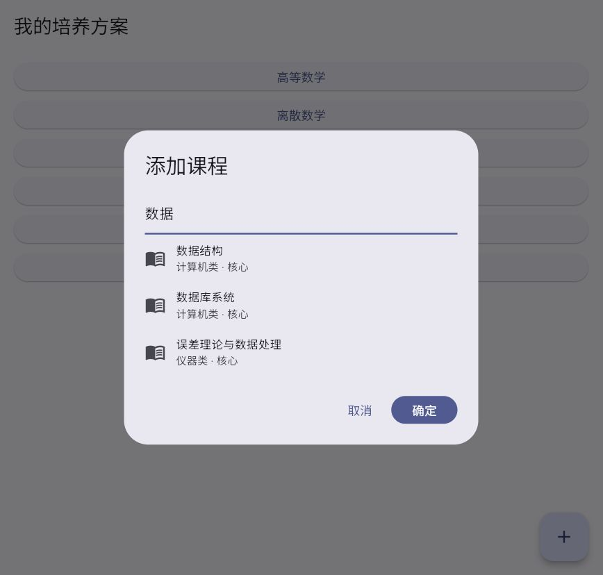

# 我的培养方案 · 课程助手

一个基于 Flutter 的高等教育课程管理小应用：维护自己的培养方案课程表，点击课程即可查看课程简介，并获得中国大学 MOOC 与 B 站的对应课程/视频入口。

支持 **Android / iOS / Web / Windows**，同一套代码，针对平台差异做了降级处理。

<p align="center">
  
  <br/>
  <sub>扫码下载 APK（或前往 <a href="https://github.com/handsome-lyl/myapp2/releases/latest">Releases</a> 页面）</sub>
</p>

---

## 功能截图

| 首页 · 我的课程 | 添加课程 · 输入联想 | 课程详情 · 简介与推荐 |
|:---:|:---:|:---:|
|  |  |  |

---

## 功能说明

### 1. 课程列表与本地存储

- 主页展示「我的培养方案」课程列表，点击任意课程进入详情页。
- 右下角加号新增课程，数据通过 `shared_preferences` 持久化：Web 写入浏览器 `localStorage`，Android 写入 SharedPreferences，Windows 写入注册表，重启后不丢失。
- 重复添加会提示，不会产生重复项。

### 2. 添加课程 · 输入联想

- 输入关键词（如「数据」）即从内置课程库中联想出匹配课程，并显示所属专业类与课程类型（核心 / 专业选修）。
- 点击联想项直接添加，避免课程名拼写不一致导致后续匹配失败。

### 3. 课程详情 · 课程简介

简介按以下优先级获取：

1. **内置课程库**（全平台可用、离线）：显示学科门类、专业类、课程类型与简介正文，并标注来源「内置课程库」。
2. **百度百科接口**（仅 Android / Windows 等 IO 平台）：内置库未收录时实时请求百度百科词条，展示摘要。
3. **兜底**：都取不到时提示「该课程暂未收录本地课程库」，并提供「在百度百科中查看」按钮跳转网页。

> Web 端因浏览器同源策略（CORS）无法直接请求百度百科接口，故固定走内置库与兜底逻辑。

### 4. 推荐教程 · 直达具体课程

- 慕课（中国大学 MOOC）与 B 站的具体课程页 / 视频页，**直接跳转对应页面，不是平台首页**。
- 每条链接在收录前均经过 HTTP 校验：无效的慕课课程 ID 会被平台重定向回首页，此类链接一律剔除。
- 慕课没有对应课程的科目（如机器学习），只展示 B 站视频，不展示慕课入口。
- 未收录的课程仍提供 B 站搜索入口作为兜底。

### 5. 内置数据规模

| 数据 | 数量 | 说明 |
|---|---|---|
| 课程条目 | 441 条（去重 419 门） | 覆盖《普通高等学校本科专业目录》全部 **92 个专业类** |
| 学科门类 | 12 个 | 哲、经、法、教、文、史、理、工、农、医、管、艺 |
| 慕课直达链接 | 320 条 | 212 门课有对应课程页 |
| B 站直达视频 | 836 条 | 418 门课各有 2 个按播放量排序的视频 |

课程库仅收录**专业核心课与专业选修课**，不含素质选修课。

---

## 技术实现

- **框架**：Flutter 3（Material 3），单套代码多端运行
- **网络**：`dio`（百度百科接口请求）
- **本地存储**：`shared_preferences`（课程列表持久化）
- **外部跳转**：`url_launcher`（打开慕课 / B 站 / 百科页面）
- **数据资源**：`assets/course_db/*.json`，启动时由 `CourseDb` 与 `CourseLinkDb` 一次性加载入内存，支持 O(1) 精确查找与关键词联想

### 平台适配

项目通过 `kIsWeb` 判断平台能力，对浏览器限制的接口做降级：

| 能力 | Android / Windows | Web |
|---|---|---|
| 课程列表持久化 | ✅ SharedPreferences | ✅ localStorage |
| 内置课程库简介 | ✅ | ✅ |
| 百度百科实时简介 | ✅ | ❌ 改用内置库 + 百科跳转 |
| 外部链接跳转 | ✅ 系统浏览器 | ✅ 新标签页 |

---

## 目录结构

```
lib/
├── main.dart                     # 入口：加载课程库与链接库后启动
├── models/
│   ├── course_entry.dart         # 课程条目（名称/门类/专业类/类型/简介）
│   └── course_recommend.dart     # 推荐教程条目与课程简介数据结构
├── pages/
│   ├── home_page.dart            # 课程列表、添加课程、输入联想
│   └── course_detail_page.dart   # 课程简介 + 推荐教程
└── services/
    ├── course_db.dart            # 内置课程库加载与查找
    ├── course_link_db.dart       # 慕课/B 站直达链接库
    └── course_recommend_data.dart# 精选推荐与兜底搜索入口

assets/course_db/
├── social.json                   # 哲学/经济/法学/教育/文学/历史（17 个专业类）
├── science.json                  # 理学（12 个专业类）
├── engineering_a.json            # 力学至计算机（9 个专业类）
├── engineering_b.json            # 土木至公安技术（22 个专业类）
├── agri_med_mgmt_art.json        # 农学/医学/管理学/艺术学（32 个专业类）
└── links.json                    # 逐条验证过的课程与视频直达链接
```

---

## 本地运行

```bash
# 安装依赖
flutter pub get

# 网页版
flutter run -d chrome

# Android（需连接设备或启动模拟器后执行）
flutter run -d emulator-5554

# 构建安装包
flutter build apk --release
```

要求：Flutter 3.x（Dart 3.x）。

---

## 已知限制

- 慕课课程会按开课轮次上下架，个别直达链接可能随时间失效；失效后可用兜底的 B 站入口。
- Web 端受 CORS 限制，无法展示内置库之外的课程简介。
- 内置课程库为各专业类的核心课程集合，并非平台全部课程（国家智慧教育平台高等教育在线课程约 3.1 万门，同名课程存在多个学校版本）。
